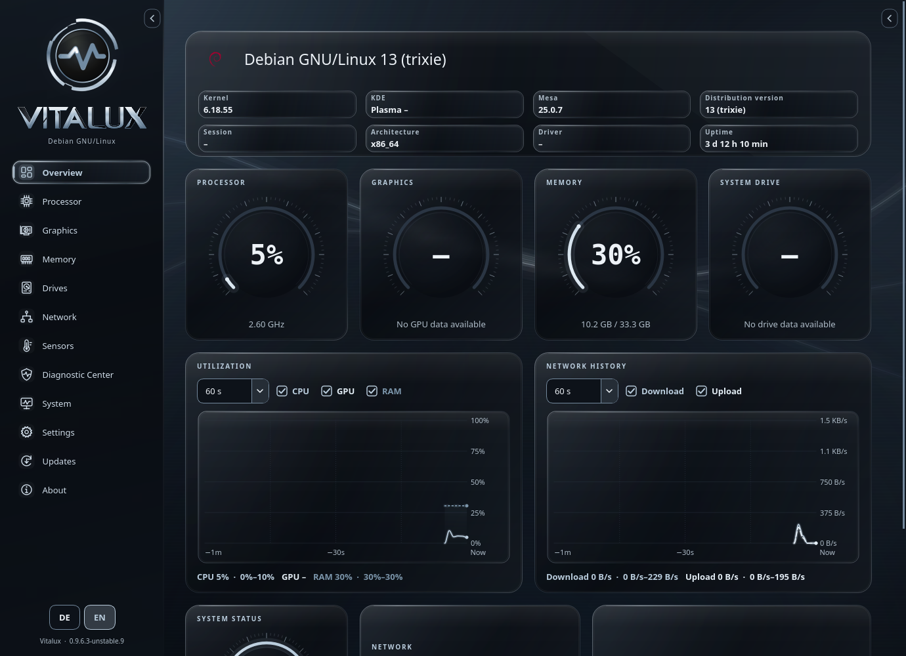
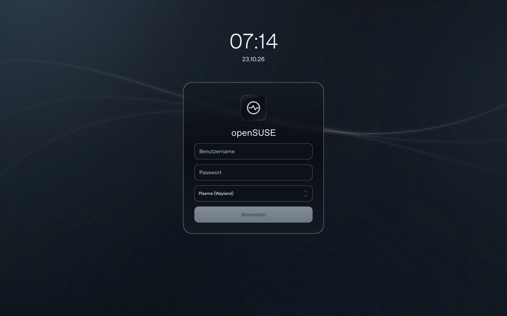

# Vitalux Liquid Silver · KDE

**[Download the installable ZIP](https://github.com/PAAAUUULLOOOH/Vitalux-KDE-Theme/raw/refs/heads/main/downloads/Vitalux-Liquid-Silver-openSUSE-1.1.0.zip)** · [SHA-256](downloads/Vitalux-Liquid-Silver-openSUSE-1.1.0.zip.sha256)

A KDE adaptation of **Vitalux’s Liquid Silver design** for **openSUSE Tumbleweed, Plasma/KWin 6.8.x, Wayland, x86_64**. Original dark smoked glass, satin-silver accents, soft polished edges and the original Vitalux atmosphere.

The palette is extracted from Vitalux’s source, rather than approximated. The lossless 4K reference wallpaper is pixel-identical to the original Liquid Silver renderer. Source commit, hashes, material stops and derived control colors are recorded in [`package/design/vitalux.json`](package/design/vitalux.json).

## Install

Extract the ZIP, close Discord and Steam, then open a terminal in the extracted folder:

```bash
bash install.sh
```

Start as your regular desktop user. The installer verifies package hashes, saves the original settings, installs build dependencies from your configured openSUSE repositories and builds the native glass effect against your KWin. It requests sudo for system components. Internet access is required. Missing Vencord/Millennium loaders are explained and require confirmation; pinned downloads are checked with SHA-256.

Log out and back in once. The installer does not terminate applications or restart the display manager.

```bash
bash install.sh --check        # Check package and target without installing
bash install.sh --no-firefox   # Keep Firefox chrome unchanged
bash uninstall.sh             # Restore the previous desktop and app settings
```

To replace version 1.0.0, run the new installer directly. The original pre-install backup is retained, so uninstall restores your original desktop rather than the old light theme. Keep the extracted directory for removal.

## Desktop and apps

| Component | Included styling |
|---|---|
| Plasma | Dark palette, smoked panels/menus, silver selections and polished SVG edges |
| KWin / Qt | Native blur/refraction effect, Kvantum Qt6 controls, Aurorae glass frames; matching engine sources included |
| openSUSE and app icons | Installed original symbols on a dark silver-edged glass plate; standard Breeze Dark control icons |
| Cursor | Multiple sizes through 96 px; silver animated wait/progress indicators |
| Background | Original Vitalux Liquid Silver atmosphere, exported at 4K |
| Startup, login, lock | Animated splash, frosted SDDM card, matching lock wallpaper and palette; native authentication retained |
| KDE apps / Haruna | System colors, supported Qt controls, icons and frames; video stays opaque and sharp |
| Firefox | Reversible browser chrome in existing native/Flatpak profiles; pages and security indicators retained |
| Discord | Liquid Silver colors/surfaces through Vencord Quick CSS |
| Steam | Liquid Silver Millennium skin, automatically selected; native/Flatpak loader integration |
| TeamSpeak 3 | Matching Qt stylesheet enabled through a user-local desktop entry |
| ProtonPlus / GTK | GTK3 and GTK4/libadwaita styles, including existing ProtonPlus Flatpak profiles |

Your panel layout and application data stay intact. Applications retain their own structure; the original Vitalux colors, atmosphere and glass material are translated to each supported toolkit. This is not a claim of pixel-identical layouts across independent applications.

Vencord and Millennium are third-party extensions; future client updates can affect their compatibility. Flatpak Steam uses its own persistent runtime directory and a local launcher argument, without broad filesystem access. Newly added Vencord permissions are tracked for removal.

## Recovery and removal

The installer journals user files/per-key settings in `~/.local/state/liquid-glass-kde` and system components in `/var/lib/liquid-glass-kde`. Uninstall preserves unrelated settings and subsequent manual changes. Previously installed app loaders remain; loaders added by this installer are removed. Distribution build dependencies remain installed.

After a KWin update, the startup guard retains native blur if the effect binary no longer matches the running compositor. Rerun `install.sh` after updates within KWin 6.8.x. Other Plasma versions are explicitly rejected.

```bash
python3 package/tools/full_install.py status
```

## Reference, validation and licenses

The original Vitalux source snapshot and a real Vitalux screenshot are in [`package/reference/vitalux/`](package/reference/vitalux/). [`package/previews/`](package/previews/) contains native QtQuick renders of the KDE login/start components, not a screenshot of a complete Plasma desktop. Their original ring motif is a preview placeholder; installation uses the locally installed openSUSE mark.

See [VALIDATION.md](package/VALIDATION.md). Automated tests cover palette/source fidelity, the 1.0.0 upgrade baseline, installation/restoration, profiles, file/path protections and app-loader configuration. Native QML, SVG, cursor and shader checks passed. A complete openSUSE build/session and real Steam/Discord/SDDM login sessions could not be verified here; the target installer builds and reports failures explicitly.

Installer/build scaffolding: MIT. **Vitalux’s original source and derived visual materials retain their existing licensing position**, described in [LICENSE-NOTICE.md](LICENSE-NOTICE.md). Third-party engines keep their own licenses; see [THIRD_PARTY_NOTICES.md](package/THIRD_PARTY_NOTICES.md) and [`package/vendor/`](package/vendor/). Application/distribution marks retain their owners’ rights.

German instructions: [ANLEITUNG.md](package/ANLEITUNG.md).

## Visual reference

Original Vitalux Liquid Silver, captured from the running app:



Native QtQuick rendering of the included SDDM theme (preview logo):



## Development

The standalone installer package is under `package/`; the repository’s root shell scripts forward to it. Checks use temporary profiles:

```bash
python3 -m unittest discover -s tests -v
```

To regenerate the design, use a development environment with PySide6 and Pillow:

```bash
QT_QPA_PLATFORM=offscreen python3 tools/import_vitalux_design.py --source /path/to/Vitalux --skin liquid_silver
python3 tools/build_cursors.py
python3 tools/build_theme.py
python3 tools/build_release.py
```

The imported Vitalux checkout must match the source you intend to use; the importer records its exact commit and source hashes. ZIP builds exclude developer caches and include their own integrity manifest.
